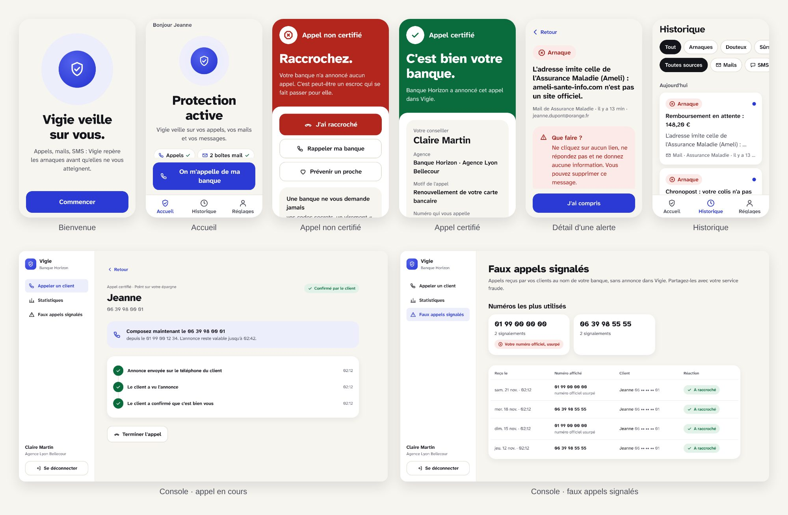

# Vigie

Protection anti-arnaque pour les seniors et leurs familles, et console pour les banques.

- **Appel certifié** : le conseiller annonce son appel depuis la console ; le téléphone du client affiche
  « Appel certifié » avec son nom. Un appel « de la banque » non annoncé est signalé, et filtré sur Android.
- **Mails, SMS, WhatsApp** : chaque nouveau message est vérifié (expéditeur, liens, site, texte) et reçoit un verdict
  clair : Sûr, Douteux ou Arnaque, avec une phrase d'explication.
- **Un proche** peut être prévenu automatiquement.



## Démarrer (Codespaces)

```bash
npm install
cp .env.example .env
npm run db:up                    # Postgres via docker compose
npm run seed -w @vigie/server    # base + données de démo
npm run dev:server               # API sur :4000
npm run dev:console              # console banque sur :3000
```

- Console : `conseiller@banque-horizon.test` / `vigie-demo`
- App : numéro `06 39 98 00 01`, code `000000` (développement uniquement)

## App mobile

L'app utilise des modules natifs (filtrage d'appels, extensions iOS) : il faut un **dev build**, pas Expo Go.

```bash
cd apps/mobile
npx eas build -p android --profile development   # puis installer l'APK sur le téléphone
npx expo start --dev-client
```

Aperçu rapide dans le navigateur (sans les fonctions natives) : `npx expo export -p web`.

Voir `CLAUDE.md` pour l'architecture, les décisions et la suite.
